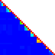
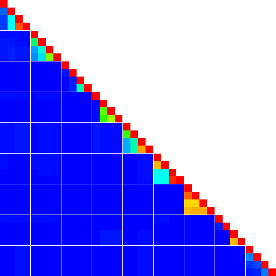

This is the CLI interface of heatman.
The CLI interface is implemented in the `heatman` crate, which is a binary crate.
The main function of the CLI interface is to parse the command line arguments and
call the appropriate functions in the `heatman` library crate.

## 🏃 Usage

```sh
$ heatman testdata/sample.csv
# generate heatman.png
$ heatman --help
Heatmap generator for visualizing data in a matrix format.

Usage: heatman [OPTIONS] [INPUT_FILE]

Arguments:
  [INPUT_FILE]  Input files containing the data to be plotted. The csv file should contain the row and column header.

Options:
  -d, --dest <DEST>
          Destination path for the output image [default: heatman.png]
  -a, --assistant-line-gap <ASSISTANT_LINE_GAP>
          Assistant line gap in cells. If 0, no assistant line will be drawn. [default: 0]
  -p, --pixel <PIXEL>
          Pixel size of cells [default: 3]
  -m, --mode <MODE>
          Output mode [default: heatmap] [possible values: scaler, heatmap, rows, columns]
  -l, --level <LEVEL>
          Logging level (trace, debug, info, warn, error) [default: warn] [possible values: trace, debug, info, warn, error]
  -r, --range <RANGE>
          Specify the value range for the input data. [default: 0-1]
  -c, --color <COLOR>
          Color of the heatmap, specified as <NAME>[:<FROM>-<TO>] or <RRGGBB>-<RRGGBB>.
          full-color: the hue from blue (minimum) to red (maximum).
          red, green, blue, yellow, cyan, magenta: from white to the color.
          redblack, greenblack, blueblack, yellowblack, cyanblack, magentablack: from black to the color.
          gray: from white to black.
          FROM and TO are the strength (0-255) of the color for the minimum and maximum values (default: 0-255).
          If FROM is greater than TO, the gradient is reversed (e.g., gray:255-0).
          RRGGBB-RRGGBB is the gradient between two colors in hex (e.g., ff0000-ffffff). [default: full-color]
      --order <ORDER>
          The file describing the order of the data to be plotted.
          Each line should contain a single string that matches the name of the data to be plotted.
          The triple dash line (---) means the assistant line is drawn here.
          The # is the comment line. escape the # with \# if you want to use it as a name.
          If not provided, the order will be determined by the order of the data in the input files.
      --row-order <ROW_ORDER>
          The file describing the order of the rows to be plotted.
      --column-order <COLUMN_ORDER>
          The file describing the order of the columns to be plotted.
  -h, --help
          Print help (see more with '--help')
  -V, --version
          Print version
$ heatman -p 15 -d heatman_with_assistant_line.png -a 4 testdata/sample.csv
# generate heatman_with_assistant_line.png with assistant lines gapped between 4 cells.
$ heatman --mode scaler -d scaler.png
# generate scaler.png, which shows the scaler of colors.
$ heatman -c gray -d heatman_gray.png testdata/sample.csv
# generate heatman_gray.png in gray scale (white for the minimum, black for the maximum).
$ heatman -c 000080-ffff00 -d heatman_navy_yellow.png testdata/sample.csv
# generate heatman_navy_yellow.png with the gradient from navy (minimum) to yellow (maximum).
```

### 🚶 The results of examples

Each image is generated by above command.

#### 🌃 `heatman.png`



It was too small.
The one cell in csv is shown in one pixel.

#### 🎑 `heatman_with_assistant_line.png`

The one cell in csv is shown in 15-pixel.



#### 🌄 `heatman_scaler.png`

This is generated scaler image.
The left side shows 0.0, and the right side shows 1.0.


